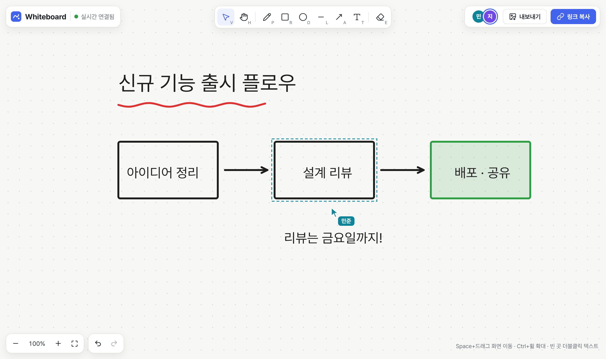
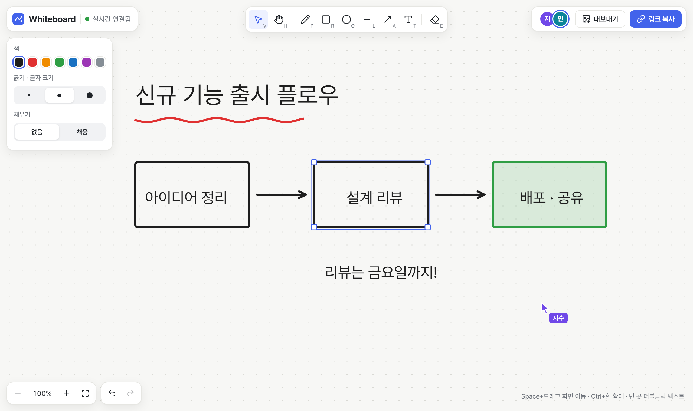
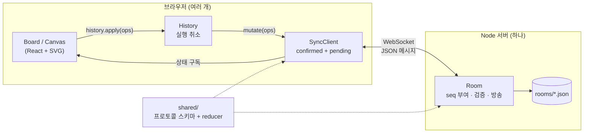

# Collab Whiteboard

링크 하나로 여러 사람이 동시에 그리는 실시간 협업 화이트보드입니다.
WebSocket 위에 **서버 권위 동기화 프로토콜**을 직접 설계해서, 동시에 고쳐도, 연결이 끊겼다 붙어도, 서버가 재시작돼도 모두가 같은 그림을 보게 만들었습니다.

> 직접 실행해 보려면 아래 [실행](#실행)을 보세요. 탭 두 개로 열면 바로 함께 그려 볼 수 있어요.

| 지수의 화면 — 민준의 커서와 선택이 보임 | 민준의 화면 — 지수의 커서가 보임 |
| --- | --- |
|  |  |

## 기능

- **그리기**: 펜, 사각형, 원, 선, 화살표, 텍스트, 지우개 / 이동, 크기 조절, 색·굵기·채우기
- **실시간 협업**: 다른 사람의 커서, 이름, 선택 영역이 보임 / 링크 복사로 초대
- **끊겨도 안전**: 오프라인에서 그린 것은 다시 연결되면 자동 전송, 그 사이의 남의 변경도 받아옴
- **협업용 실행 취소**: `Ctrl+Z`는 내가 바꾼 것만 되돌리고 남의 작업은 건드리지 않음
- **보존**: 보드는 서버에 저장되어 새로고침·서버 재시작 후에도 그대로
- **기타**: 무한 캔버스(팬/줌), PNG 내보내기, 최근 보드 목록, 한글 입력 상태에서도 동작하는 단축키, 모바일 레이아웃

| 단축키 | 동작 |
| --- | --- |
| `V` `H` `P` `R` `O` `L` `A` `T` `E` | 선택 · 이동 · 펜 · 사각형 · 원 · 선 · 화살표 · 텍스트 · 지우개 |
| `Ctrl+Z` / `Ctrl+Shift+Z` | 실행 취소 / 다시 실행 |
| `Delete` · 방향키(`Shift`: 10px) | 삭제 · 미세 이동 |
| `Space`+드래그 · 휠 · `Ctrl`+휠 | 화면 이동 · 스크롤 · 확대/축소 |
| 빈 곳 더블클릭 · 텍스트 더블클릭 | 텍스트 쓰기 · 텍스트 고치기 |
| `Shift`+드래그 | 정사각형/정원, 45도 단위 선 |

## 실행

Node.js 24 이상이 필요합니다(서버의 TypeScript를 빌드 없이 실행하기 위해 Node의 타입 제거 기능을 씁니다).

```bash
npm install

# 개발: http://localhost:5173 (서버는 3000번 포트)
npm run dev

# 프로덕션: 빌드 후 서버 하나가 화면과 WebSocket을 모두 제공 → http://localhost:3000
npm run build
npm start
```

| 환경 변수 | 기본값 | 설명 |
| --- | --- | --- |
| `PORT` | `3000` | 서버 포트 |
| `DATA_DIR` | `./data` | 보드 저장 폴더 |

```bash
npm test            # 단위 + 통합 테스트 (Vitest)
npm run test:e2e    # 브라우저 E2E (Playwright, 처음에는 npx playwright install chromium)
npm run typecheck
```

Docker:

```bash
docker build -t collab-whiteboard .
docker run -p 3000:3000 -v whiteboard-data:/data collab-whiteboard
```

## 구조



```
shared/      서버와 클라이언트가 함께 쓰는 코드
  protocol.ts  메시지·도형 스키마(zod)와 타입
  doc.ts       reducer(applyOps), 전송 전 압축(compressOps)
server/
  room.ts      방 하나의 권위 있는 상태: 순서 부여, 중복 제거, 검증, 재접속 동기화
  app.ts       HTTP/WebSocket 서버, 방 로드·저장·정리, 죽은 연결 정리
  storage.ts   방 스냅샷 파일 저장(임시 파일 + rename)
client/src/
  sync/        SyncClient(연결·낙관적 업데이트·재접속), History(협업 실행 취소)
  board/       캔버스, 도형 렌더링, 도구, UI
e2e/         두 브라우저로 협업 시나리오를 검증하는 Playwright 테스트
docs/        프로토콜 설계 문서
```

## 동기화 설계 요약

자세한 내용과 시퀀스 다이어그램은 [docs/protocol.md](docs/protocol.md)에 있습니다.

1. **서버가 순서를 정합니다.** 모든 변경은 서버를 거치며 방 단위로 1씩 증가하는 `seq`를 받습니다. 서버와 클라이언트가 같은 reducer를 같은 순서로 적용하므로 모두 같은 상태가 됩니다.
2. **화면 = 확정 상태 + 내 대기 변경.** 내 변경은 바로 화면에 보이고(낙관적 업데이트), 서버가 거부하면 대기열에서 빼는 것만으로 롤백됩니다.
3. **충돌은 속성 단위 last-writer-wins.** 한 사람은 옮기고 한 사람은 색을 바꾸면 둘 다 반영되고, 같은 속성이면 서버에 나중에 도착한 값이 남습니다. 삭제는 수정을 이깁니다.
4. **재접속은 증분, 안 되면 스냅샷.** 마지막으로 받은 `seq`를 알려주면 서버는 놓친 커밋만 보내고, 로그에서 밀려났으면 전체 상태를 보냅니다.
5. **같은 변경은 한 번만.** 클라이언트별 `clientSeq`를 멱등 키로 써서, 응답을 못 받아 재전송한 변경이 두 번 반영되지 않게 합니다.
6. **보내는 양을 줄입니다.** 50ms마다 모아 보내고, 같은 도형의 연속 수정(드래그 중 좌표)은 마지막 값 하나로 합칩니다.

### 왜 CRDT를 쓰지 않았나

중앙 서버가 이미 있고, 화이트보드 도형은 서로 독립적이라 "서버 순서 + 속성 단위 LWW"로 충분하다고 판단했습니다. 상태가 평범한 JSON이고 모든 변경에 순번이 있어 설명과 디버깅이 쉽습니다. 대신 서버 없는 P2P 동기화와 텍스트 글자 단위 동시 편집은 포기했습니다. 근거와 트레이드오프는 [설계 문서](docs/protocol.md#10-왜-이렇게-만들었나)에 정리했습니다.

## 테스트

| 종류 | 대상 | 내용 |
| --- | --- | --- |
| 단위 | `shared/doc.ts` | 충돌 규칙(속성 단위 LWW, 삭제 우선), 압축 전후 결과 동일 |
| 단위 | `server/room.ts` | 중복 제거, 증분/스냅샷 재동기화, 상태 기준 검증, 연결 교체 |
| 단위 | `client/src/sync/History.ts` | 드래그 묶기, 남의 변경 보존, 남이 지운 도형 미복원 |
| 통합 | 실제 서버 + `SyncClient` 여러 개 | 오프라인 편집 후 병합, **응답 유실 시 중복 반영 방지**, 거부 시 롤백, **서버 재시작 후 자동 복구**, **3명 × 300단계 무작위 편집·끊김 후 수렴(고정 시드)** |
| 서버 | `server/app.ts` | 잘못된 메시지 차단, 손상된 저장 파일, 경로 탐색 차단 |
| E2E | 브라우저 2개 (Playwright) | 실시간 반영과 커서, 오프라인 후 전달, 내 변경만 실행 취소, 텍스트 수정, 새로고침 후 유지 |

통합 테스트는 브라우저 없이 Node에서 실제 WebSocket으로 서버에 붙습니다. `SyncClient`가 브라우저 표준 `WebSocket`만 쓰기 때문에 같은 코드를 그대로 테스트할 수 있습니다.

## 한계와 다음 단계

- **인증 없음**: 링크(추측하기 어려운 10자리 id)를 아는 사람은 누구나 편집할 수 있습니다.
- **서버 한 대**: 방 상태를 서버 메모리에 두므로 수평 확장하려면 방 단위로 서버를 고정(sticky)하거나 Redis 등으로 방 소유권을 나눠야 합니다.
- **비정상 종료 시 최대 1초 손실**: 저장을 1초 단위로 모아 하기 때문입니다(정상 종료 시에는 모두 저장).
- **텍스트 동시 편집**: 같은 텍스트를 동시에 고치면 나중 값이 이깁니다. 필요하면 텍스트만 CRDT(Yjs `Y.Text`)로 바꿀 수 있습니다.
- **새로고침 시 미전송 변경**: 오프라인 상태에서 그린 것은 탭을 닫으면 사라집니다(닫기 전에 경고). IndexedDB에 대기열을 저장하면 해결됩니다.
- **요청 빈도 제한 없음**: 메시지 크기·도형 수는 제한하지만, 연결당 초당 메시지 수는 제한하지 않습니다.
- **중복 제거 기록이 계속 늘어남**: 클라이언트별 마지막 `clientSeq`를 페이지를 열 때마다 하나씩 저장하므로, 오래 쓰는 보드에서는 오래된 항목을 정리하는 기준이 필요합니다.
- 복사/붙여넣기, 도형 그룹, 레이어 순서 변경은 아직 없습니다.

## 라이선스

MIT
