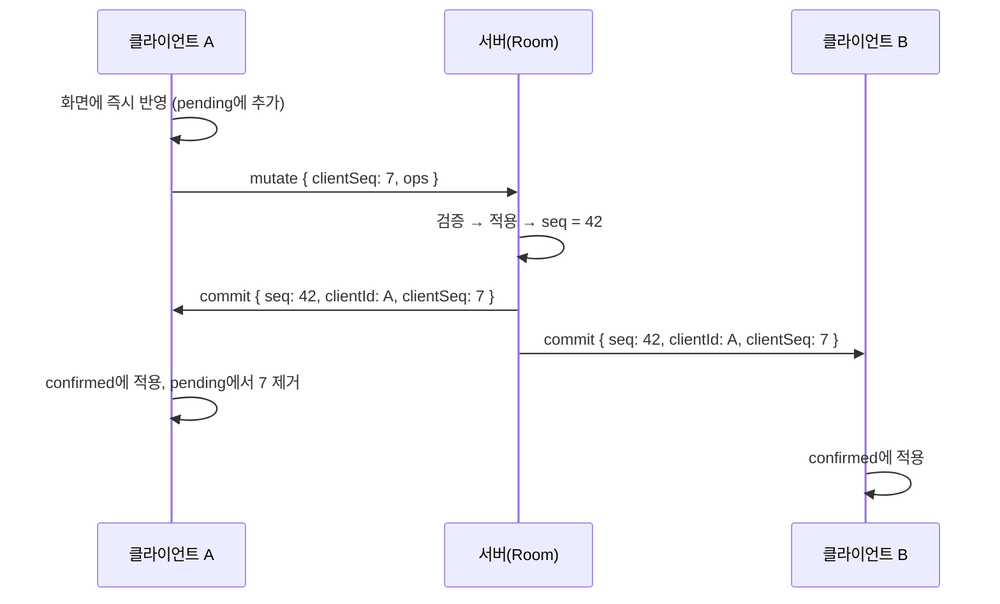
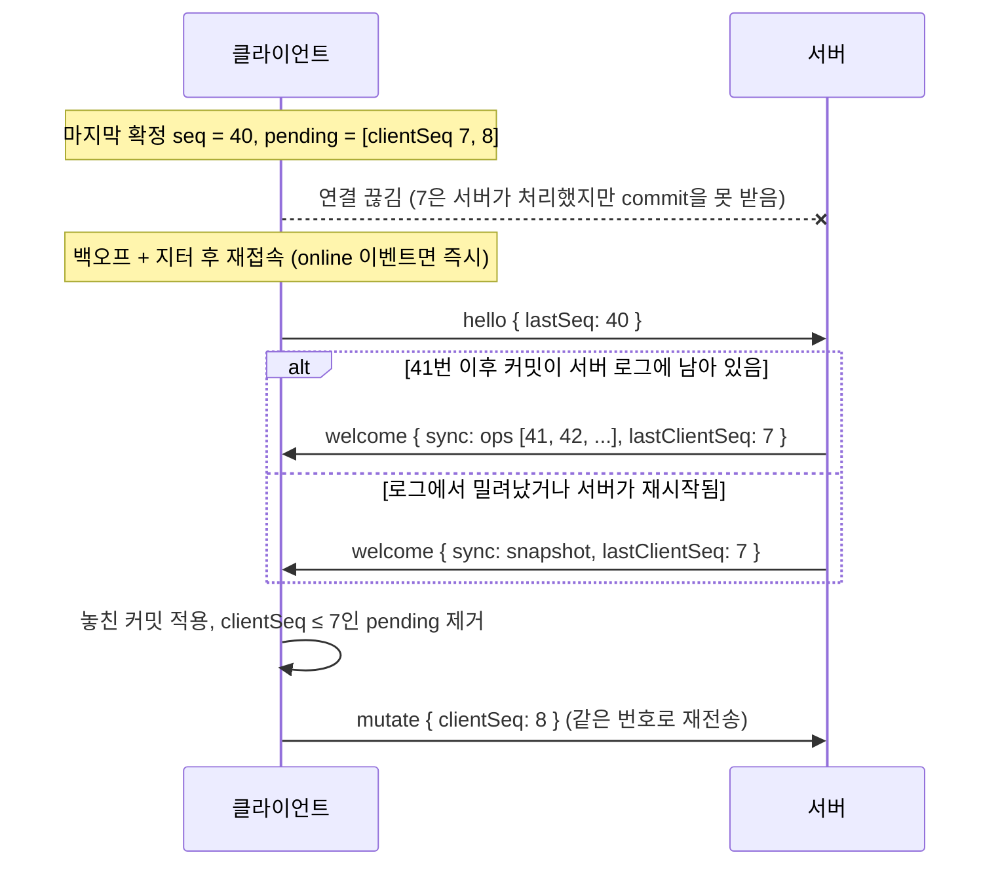

# 동기화 프로토콜 설계

이 문서는 "여러 사람이 같은 보드를 동시에 고쳐도, 연결이 끊겼다 붙어도, 모두가 같은 그림을 보게 되는가"에 대한 설계를 설명합니다. 코드와 함께 읽을 수 있도록 각 절에 해당 파일을 적어 두었습니다.

## 1. 한 문장 요약

**서버가 모든 변경의 순서(seq)를 정하고, 클라이언트는 "서버가 확정한 상태" 위에 "아직 확정받지 못한 내 변경"을 덧씌워 화면에 그립니다.**
서버와 클라이언트는 같은 reducer(`shared/doc.ts`)를 쓰기 때문에, 같은 순서로 적용하면 결과가 같습니다.

## 2. 데이터 모델 — `shared/protocol.ts`

보드는 `id → 도형` 맵 하나입니다. 도형끼리는 서로를 참조하지 않으므로, 도형 하나에 대한 변경은 다른 도형에 영향을 주지 않습니다.

| 도형 | 주요 속성 |
| --- | --- |
| `rect`, `ellipse` | `x, y, w, h, fill` |
| `line` | 시작점 `x, y`, 끝점까지의 벡터 `dx, dy`, `arrow` |
| `pen` | `x, y` 기준 상대 좌표 `points: [x0, y0, x1, y1, ...]` |
| `text` | `x, y, text, fontSize` |

공통: `id, z(쌓임 순서), stroke, strokeWidth`

펜과 선의 좌표를 `(x, y)` 기준 상대값으로 저장하는 이유: 이동할 때 `x, y` 두 값만 바꾸면 되므로 메시지가 작고, 이동과 모양 수정이 서로 다른 속성이 되어 동시에 일어나도 충돌하지 않습니다.

변경(op)은 세 가지뿐입니다.

```ts
{ type: 'add', shape }               // 도형 추가
{ type: 'update', id, patch }        // 패치에 담긴 속성만 덮어쓰기
{ type: 'delete', id }               // 삭제
```

## 3. 메시지

| 방향 | 메시지 | 의미 |
| --- | --- | --- |
| C → S | `hello { roomId, clientId, lastSeq, user }` | 접속. `lastSeq`는 마지막으로 확정받은 seq(처음이면 `null`) |
| C → S | `mutate { clientSeq, ops }` | 변경 묶음. `clientSeq`는 클라이언트별 단조 증가 번호(멱등 키) |
| C → S | `presence { user, cursor, selection }` | 커서와 선택 영역. 저장하지 않음. `selection`은 방에 있는 도형 id만 남겨 전달 |
| C → S | `ping` | 연결 확인 |
| S → C | `welcome { seq, lastClientSeq, sync, peers }` | 접속 응답. `sync`는 놓친 커밋 목록 또는 전체 스냅샷 |
| S → C | `commit { seq, clientId, clientSeq, ops }` | 서버가 순서를 확정한 변경. **보낸 사람에게도** 보냄 |
| S → C | `reject { clientSeq, reason }` | 서버가 거부한 변경. 보낸 사람에게만 보냄 |
| S → C | `presence`, `leave` | 다른 사람의 커서/선택, 퇴장 |
| S → C | `pong` | ping 응답 |

`commit`을 보낸 사람에게도 보내는 것이 곧 확인(ack)입니다. "내 변경 확인"과 "남의 변경 적용"이 같은 코드 경로를 타기 때문에 처리할 경우의 수가 줄어듭니다.

## 4. 정상 흐름



### 클라이언트 상태 — `client/src/sync/SyncClient.ts`

```
confirmed  : 서버가 확정한 상태 (seq까지 반영)
pending[]  : 아직 확정받지 못한 내 변경 묶음 (보낸 것 + 아직 안 보낸 것 1개)
화면       = confirmed에 pending을 순서대로 적용한 결과
```

- **내 변경**: `pending`에 넣고 화면에 바로 반영합니다(낙관적 업데이트).
- **commit 수신**: `confirmed`에 적용하고, 내 것이면 `pending`에서 뺀 뒤 화면을 다시 계산합니다. 남의 변경이 내 변경보다 먼저 확정됐다면, 다시 계산하는 과정에서 "남의 변경 위에 내 변경"이 자연스럽게 다시 올라갑니다(rebase).
- **reject 수신**: 해당 묶음을 `pending`에서 빼고 화면을 다시 계산합니다. 롤백을 위한 별도 코드가 없습니다. 서버가 확정한 상태로 돌아가는 것이 곧 롤백입니다.

### 보내는 빈도 — 묶음과 압축

드래그 중에는 `pointermove`마다 변경이 생깁니다(초당 60~120번). 이를 그대로 보내지 않고 **50ms마다 한 번** 보냅니다.
아직 보내지 않은 변경은 `pending`의 마지막 묶음 하나에 계속 합쳐지고, 합칠 때 `compressOps`로 **같은 도형의 연속 수정을 하나로** 줄입니다(`x: 1 → 2 → 3`이면 `x: 3`만 보냄). 서로 다른 도형의 op는 순서를 바꿔도 결과가 같기 때문에 가능한 압축입니다.

오프라인 동안의 변경도 같은 방식으로 하나의 묶음에 쌓이고, 다시 연결되면 크기(500개 / 약 256KB) 기준으로 나눠 보냅니다.

## 5. 충돌 규칙

중앙 서버가 순서를 정하므로, "동시에"라는 것은 없습니다. 서버에 먼저 도착한 것이 먼저입니다.

| 상황 | 결과 |
| --- | --- |
| A는 도형을 옮기고(`x, y`) B는 색을 바꿈(`stroke`) | **둘 다 반영**. 패치는 담긴 속성만 덮어씀 |
| A와 B가 같은 속성(`x`)을 바꿈 | **서버에 나중에 도착한 값**이 남음 (속성 단위 last-writer-wins) |
| A가 지운 도형을 B가 수정 | **삭제가 이김**. 없는 도형에 대한 update는 무시 |
| 같은 id로 add | 이미 있으면 무시 (id는 클라이언트가 62진수 12자리 난수로 생성) |
| 쌓임 순서(`z`)가 같음 | id 순으로 정렬해 모든 클라이언트에서 같은 순서 |

텍스트 도형의 `text`도 하나의 속성이므로, 두 사람이 같은 텍스트를 동시에 고치면 나중 값이 이깁니다. 글자 단위 병합이 필요하면 그 부분만 CRDT(예: Yjs의 `Y.Text`)를 쓰는 것이 맞는 방향입니다(아래 한계 참고).

## 6. 연결이 끊겼을 때

### 재접속 흐름



### 같은 변경이 두 번 반영되지 않게 — 멱등성

"보냈는데 확인을 못 받은" 변경은 서버가 처리했을 수도, 못 했을 수도 있습니다. 두 겹으로 막습니다.

1. **클라이언트**: `welcome.lastClientSeq`(서버가 이 클라이언트의 변경을 어디까지 처리했는지) 이하의 `pending`은 버립니다.
2. **서버**: 클라이언트별 마지막 `clientSeq`를 기억하고, 그 이하 번호의 `mutate`는 무시합니다. 이 정보는 방 스냅샷과 함께 파일에 저장되어 서버 재시작 후에도 유지됩니다.

중복 반영이 왜 위험한가: `update`는 값을 덮어쓰는 연산이라 한 번 더 적용해도 같아 보이지만, **그 사이에 다른 사람이 같은 속성을 바꿨다면** 오래된 값이 최신 값을 덮어씁니다. 통합 테스트 `서버가 처리했지만 응답을 못 받은 변경을 재전송해도 한 번만 반영된다`가 정확히 이 상황을 재현합니다.

`clientId`는 페이지를 열 때마다 새로 만듭니다(탭을 복제해도 겹치지 않도록 저장소에 두지 않음). 재접속해도 같은 페이지 안에서는 유지됩니다.

### 죽은 연결 감지

| 쪽 | 방법 |
| --- | --- |
| 서버 | 30초마다 WebSocket ping 프레임. 다음 주기까지 pong이 없으면 연결 종료 |
| 클라이언트 | 브라우저는 ping 프레임을 노출하지 않으므로 10초마다 앱 레벨 `ping`. 25초 동안 아무 메시지도 없으면 끊고 재접속 |
| 브라우저 | `offline` 이벤트에서 즉시 오프라인 표시, `online` 이벤트와 탭 복귀 시 즉시 재접속 |

재접속 간격은 `0.5초 × 2^시도 횟수`(최대 10초)에 50~100% 지터를 곱합니다. 서버가 재시작됐을 때 모든 클라이언트가 같은 순간에 몰려드는 것을 막습니다.

### seq가 비면

`commit.seq`가 `내 seq + 1`이 아니면 중간 변경을 놓친 것이므로 상태를 믿을 수 없습니다. 연결을 다시 맺고 스냅샷부터 받습니다. 정상 동작에서는 일어나지 않지만(한 연결 안의 메시지는 TCP가 순서를 보장), 버그가 조용히 상태를 어긋나게 두지 않도록 하는 안전장치입니다.

## 7. 장애 시나리오 정리

| 상황 | 처리 | 확인한 테스트 |
| --- | --- | --- |
| 네트워크 끊김 후 복구 | 변경은 대기열에 쌓이고, 다시 연결되면 전송. 그 사이 남의 변경도 받음 | 통합, E2E |
| 보냈지만 응답을 못 받음 | `lastClientSeq`로 정리 + 서버에서 `clientSeq` 중복 제거 | 통합, Room 단위 |
| 오래 끊겨서 놓친 커밋이 로그에서 밀려남 | 전체 스냅샷 후 대기 변경을 다시 얹음 | Room 단위 |
| 서버 재시작 | 1초 간격 파일 저장 + 종료 시 저장. 클라이언트는 자동 재접속 | 통합 |
| 반쯤 끊긴 이전 연결이 남아 있음 | 같은 `clientId`로 새로 들어오면 이전 연결을 닫음(코드 4000) | Room 단위 |
| 스키마에 안 맞는 메시지 | 연결 종료(1007/1008) | 서버 |
| 도형 타입에 없는 속성 수정, 도형 수 초과 | `reject` → 보낸 사람 화면 롤백 | 통합, Room 단위 |
| 방 저장 파일 손상 | 그 연결만 닫고(1011) 서버는 계속 동작 | 서버 |
| 무작위 동시 편집 + 무작위 끊김 | 3명이 300단계 무작위 편집 후 모두 같은 상태로 수렴 | 통합(고정 시드) |

## 8. 실행 취소 — `client/src/sync/History.ts`

혼자 쓰는 편집기라면 "직전 상태로 되돌리기"면 충분하지만, 협업에서는 그 사이에 다른 사람이 바꾼 것까지 지워집니다. 그래서:

- 동작 하나(드래그 한 번, 스타일 변경 한 번)마다 **바뀐 도형의 변경 전/후 모습**을 기록합니다. 드래그 중 수십 번의 이동은 `begin()`/`commit()`으로 하나로 묶입니다.
- 실행 취소는 상태를 되돌리는 것이 아니라 **"내가 바꾼 속성만 이전 값으로 되돌리는 새 op"를 만들어 보내는 것**입니다. 그래서 실행 취소도 다른 변경과 똑같이 서버를 거쳐 모두에게 전달됩니다.
- 그 사이 다른 사람이 지운 도형은 되살리지 않고, 다른 사람이 바꾼 속성은 건드리지 않습니다.

한계: 내가 바꾼 속성을 그 뒤에 다른 사람이 또 바꿨다면, 실행 취소가 그 사람의 값을 덮어씁니다.

## 9. 서버 — `server/room.ts`, `server/app.ts`

- `Room`은 소켓을 모릅니다(`Connection` 인터페이스만 앎). 그래서 소켓 없이 단위 테스트할 수 있습니다.
- 접속자가 있는 방만 메모리에 올립니다. 마지막 사람이 나가고 30초가 지나면 저장 후 내립니다.
- 저장은 변경 후 1초 모았다가 `임시 파일에 쓰기 → rename`으로 합니다. 쓰는 도중 죽어도 기존 파일이 깨지지 않습니다.
- 최근 커밋 1000개를 메모리에 두고 재접속한 클라이언트에게 증분으로 보냅니다. 커밋 로그는 저장하지 않습니다(재시작 후에는 스냅샷으로 충분).

## 10. 왜 이렇게 만들었나

### 왜 CRDT가 아니라 서버 권위 + 속성 단위 LWW인가

- **어차피 서버가 있습니다.** 저장, 접속자 관리, 입력 검증을 위해 서버가 필요하고, 서버가 순서를 정하면 모든 클라이언트가 같은 순서로 적용하는 것만으로 수렴합니다. CRDT는 중앙 순서 없이도 수렴하게 해 주는 도구인데, 이 구조에서는 그 장점을 쓸 일이 적습니다.
- **화이트보드의 도형은 서로 독립적입니다.** 문서 편집처럼 글자 사이에 끼워 넣는 연산이 없고, 대부분의 동시 수정은 "다른 도형" 또는 "같은 도형의 다른 속성"이라 속성 단위 LWW로 사람이 기대하는 결과가 나옵니다.
- **설명하고 디버깅하기 쉽습니다.** 상태는 평범한 JSON이고, 모든 변경에 seq가 붙어 있어 순서를 그대로 따라갈 수 있습니다.
- Figma도 [How Figma's multiplayer technology works](https://www.figma.com/blog/how-figmas-multiplayer-technology-works/)에서 중앙 서버가 있으므로 CRDT를 그대로 쓰지 않고, 서버가 권위를 갖는 속성 단위 last-writer-wins를 택했다고 설명합니다.

포기한 것: 서버 없이 기기끼리 직접 동기화(P2P), 오래 오프라인으로 작업한 뒤의 정교한 병합, 텍스트 글자 단위 동시 편집.

### 왜 Socket.IO가 아니라 `ws`인가

Socket.IO의 재연결은 **소켓**을 다시 이어 줄 뿐, 그 사이 **앱 상태**가 어떻게 어긋났는지는 모릅니다. 놓친 변경 받기, 중복 제거, 대기 변경 재전송은 어차피 직접 설계해야 하는 부분이라, 표준 WebSocket 위에 작은 프로토콜을 직접 정의했습니다. 덕분에 클라이언트 동기화 코드는 브라우저 표준 `WebSocket`만 쓰고, 같은 코드를 Node(테스트)에서도 그대로 실행합니다.

### 왜 Canvas가 아니라 SVG인가

도형마다 DOM 요소가 있으니 클릭 판정, 선택, 커서 모양을 브라우저에 맡길 수 있습니다. 선택 핸들과 클릭 영역은 `vector-effect: non-scaling-stroke`로 확대/축소와 관계없이 화면에서 같은 크기를 유지합니다. 도형이 수만 개가 되면 Canvas가 유리하지만, 방당 도형 수를 5000개로 제한한 이 서비스에서는 SVG의 단순함이 더 큽니다. 도형은 불변 객체로 갱신되므로 `React.memo`가 참조 비교만으로 바뀐 도형만 다시 그립니다.

## 11. 제한값 — `shared/limits.ts`

| 항목 | 값 |
| --- | --- |
| 방당 도형 수 | 5,000 |
| 묶음당 op 수 | 500 |
| 펜 획당 점 수 | 4,000 |
| 텍스트 길이 | 5,000자 |
| 방당 동시 접속 | 50명 |
| 메시지 크기 | 1MB |
